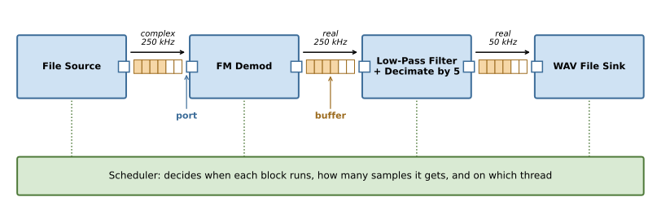
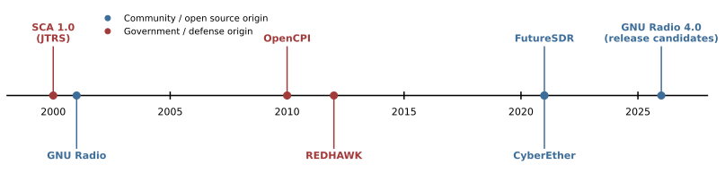

.. _sdr-frameworks-chapter:

##############
SDR Frameworks
##############

When you want to build an SDR or RF signal processing application of some sort, you must choose whether to write it as a bespoke application from scratch, or if it's worth using an existing framework.  In most a SDR frameworks, you connect pre-built processing blocks together (often with some of your own custom blocks) and a runtime handles moving samples between them.  The SDR framework tends to also come with GUIs and signal debugging tools, and sometimes support for a variety of hardware.  By creating an application within this type of framework, you automatically get support for many SDRs and you don't have to spend as much time writing GUIs and such.  In this chapter we will learn what an SDR framework actually does for you, when it's worth using one (often it's not!), and then tour the popular frameworks, from GNU Radio to government-born frameworks like REDHAWK.  As an example we will build the same FM radio receiver in each one.

************
Introduction
************

Imagine you want to listen to an FM radio station.  On a whiteboard the receiver is just a few boxes connected by arrows: get samples, FM demodulate, filter, and play the audio.  If you have an IQ recording you can write that in a dozen lines of Python.  Now imagine the samples are streaming live from an SDR, nonstop, at 250 thousand samples per second, and the audio must come out of your speakers without gaps or stutters.  The boxes and arrows haven't changed, but suddenly you need to worry about threads, buffers, what happens when one step runs slower than another, and how to process an endless stream in chunks without glitches at the chunk boundaries.  None of that is DSP, it's plumbing, and plumbing is exactly what an SDR framework provides.

Throughout this chapter we will use a single example: a mono FM broadcast receiver.  Every version, in every framework, uses the same input, which is the 250 kHz FM recording from the :ref:`rds-chapter` chapter, which you can `download here <https://github.com/777arc/498x/blob/master/fm_rds_250k_1Msamples.iq?raw=true>`_.  It contains 1 million complex64 samples (about 4 seconds) centered on an FM station received at high SNR.  Using a recording instead of live hardware means anyone can run every example without owning an SDR, and it lets us compare the frameworks on equal footing.

The receiver chain is intentionally minimal, so that it looks the same in every framework:

#. **Source**: read complex samples from the file, at 250 kHz
#. **FM demodulation**: convert the change in phase from one sample to the next into audio
#. **Low-pass filter and decimate by 5**: keep only the mono audio (below 15 kHz) and reduce the sample rate to 50 kHz
#. **Sink**: save the audio to a WAV file

A real FM receiver would also include a de-emphasis filter and resample to a standard audio rate like 48 kHz, but those steps don't change the comparison, so we leave them out.

********************************
What is an SDR Framework?
********************************

At its core, an SDR framework is a runtime that executes a graph of signal processing blocks.  You describe *what* should be connected to *what*, and the framework decides *when* each block runs and *how* samples get from one block to the next.  The diagram below shows our FM receiver as a framework sees it.  Take a moment to find each labeled part, because every framework in this chapter has its own name for these same concepts.

Let's walk through the parts:

* **Blocks** are the boxes.  Each one does a single job, like FM demodulation or filtering, and is written once and reused everywhere.  Most frameworks ship with hundreds of blocks.
* **Ports** are the connection points on each block.  A port has a data type (e.g., complex float or real float), and the framework checks that you only connect compatible ports, which catches a whole class of bugs before you even run anything.
* **Buffers** sit between blocks and hold samples that one block has produced but the next block hasn't consumed yet.  Note how the sample rate changes along the chain: 250 kHz complex, then 250 kHz real after the demod, then 50 kHz after decimation.  The framework keeps track of these rate changes so each block gets the right number of samples.
* **The scheduler** decides when each block runs, how many samples it gets to process at a time, and on which thread.  If the WAV sink falls behind, the buffer in front of it fills up, and the scheduler stops calling the upstream blocks until there is room again.  This is called **back-pressure**, and it's what keeps a fast source from overrunning a slow consumer.

On top of these core pieces, most frameworks add a library of blocks, sources and sinks for popular SDR hardware, GUI widgets for plotting, and some way to describe the graph, either graphically (dragging blocks around and drawing wires) or in code.  Graphically describing it typically involves a block diagram referred to as a "flowgraph".  Some frameworks include methods of adding metadata to specific samples, and/or providing a way to pass asynchronous messages between blocks (e.g., to change a block's parameter).

It is easy to confuse SDR frameworks with other kinds of SDR software, because many of these projects blur the lines.  The table below is a rough guide:

.. list-table::
   :widths: 20 45 35
   :header-rows: 1

   * - Category
     - What it is
     - Examples
   * - DSP library
     - Functions you call from your own code, with no scheduler or graph
     - NumPy/SciPy, `liquid-dsp <https://liquidsdr.org/>`_, VOLK, FFTW
   * - Hardware API
     - Code that gets samples to and from a specific SDR (or many SDRs)
     - UHD, libiio, SoapySDR, librtlsdr
   * - SDR framework
     - A runtime that executes a graph of reusable blocks
     - GNU Radio, REDHAWK, OpenCPI
   * - Application
     - A finished program for a specific job, possibly with plugins
     - SDR++, GQRX, SDRangel, SDR#
   * - Protocol stack
     - A complete implementation of one wireless standard
     - srsRAN, OpenAirInterface, GNSS-SDR

Note that these layers stack on top of each other.  A framework typically uses DSP libraries inside its blocks and hardware APIs inside its source/sink blocks, and some applications and protocol stacks are built on top of a framework (GNSS-SDR, for example, is built on GNU Radio).

It's also worth knowing that some popular SDR applications have plugin systems that let you add your own processing, which can cover some of the same ground as a framework.  `SDRangel <https://www.sdrangel.org/>`_ is built around channel plugins (demodulators and modulators) and feature plugins, and `SDR++ <https://www.sdrpp.org/>`_ has a module system for sources, decoders, and other add-ons.  The difference is that you are extending a specific application with a fixed structure (typically a waterfall with demodulators attached to it), rather than building an arbitrary flowgraph.

*************************
Do You Need a Framework?
*************************

Short answer: probably not, and most people working with SDRs don't use one.  If you are analyzing IQ recordings offline, writing a one-off script to test an idea, or controlling an SDR from a larger Python application, a plain script with NumPy is simpler, easier to debug, and has no learning curve beyond the DSP itself.  Many fielded RF systems also do all the high-rate processing in an FPGA, with a relatively thin piece of custom C++ on the host that doesn't benefit much from a framework.

So when *is* a framework worth it?  Here are the main benefits:

* **Tested blocks.** Costas loops, clock recovery, polyphase resamplers, and channel models are hard to get right.  A framework gives you versions that thousands of people have already debugged.
* **Streaming infrastructure.** Processing an endless stream in chunks, carrying state between chunks, threading, buffers, and back-pressure are all handled for you.
* **Performance.** Mature frameworks use SIMD-optimized kernels and run each block on its own thread, so a long chain uses many CPU cores without you writing any multithreaded code.
* **Hardware abstraction.** Swapping a USRP for a PlutoSDR can be as simple as swapping the source block.
* **Rapid prototyping.** Graphical editors let you build, run, and tweak a receiver in minutes, with sliders and live plots, which is also great for teaching.
* **Community.** You can reuse other people's blocks and entire applications, like satellite decoders or LoRa receivers.

And the drawbacks:

* **Learning curve.** You now have to learn the framework's concepts (item sizes, sample rate bookkeeping, how the scheduler behaves) on top of the DSP.
* **Hidden DSP.** A block called "WBFM Receive" works great until it doesn't, and then you need to dig into someone else's code to find out why.  This is also why PySDR teaches with plain Python: the point is to see the DSP.
* **Awkward fit for bursty logic.** Frameworks are built around continuous streams, so packet-based protocols, TX/RX turnaround with tight timing, and "do this, then wait for that" logic can feel like fighting the framework.
* **Latency.** Buffers between blocks add delay, which can matter for real-time protocols.
* **Dependencies and churn.** Installing a framework (and especially third-party blocks) can be painful, and blocks written for one major version may not work on the next.
* **Licensing.** Some frameworks are GPL licensed, which matters if you plan to ship a closed-source product.

As a rule of thumb, reach for a framework when you need continuous real-time streaming, when the blocks you need already exist, or when you want a quick interactive prototype.  Stick with a plain script for offline analysis, learning, one-off experiments, and anything where you want full control and visibility over every step.

It is no secret that in the era of AI, existing software (applications to a great extent and frameworks to a lesser extent) lose some of their value, due to how rapidly you can create new software that does exactly what you want.  Instead of taking an existing open source application and tweaking it to do what you want, it's often easier to just create it from scratch to do exactly what you want.  Frameworks, on the other hand, lose some value in the era of AI but not all their value, especially if you are planning on collaborating with others or showing off what you created.

Example: FM Receiver Without a Framework
#########################################

To make this concrete, here is our FM receiver written the PySDR way, with nothing but NumPy and SciPy.  We will process an IQ recording of FM that can be downloaded `here <https://github.com/777arc/498x/blob/master/fm_rds_250k_1Msamples.iq?raw=true>`_.  This FM receiver will be recreated in every framework we discuss in this chapter.

.. code-block:: python

 import numpy as np
 from scipy.signal import firwin, lfilter
 from scipy.io import wavfile

 sample_rate = 250e3
 x = np.fromfile('fm_rds_250k_1Msamples.iq', dtype=np.complex64)

 x = np.angle(x[1:] * np.conj(x[:-1])) # FM demod

 # Low-pass filter to keep only the mono audio (0 to 15 kHz), then decimate by 5 to get 50 kHz
 taps = firwin(101, 15e3, fs=sample_rate)
 x = lfilter(taps, 1.0, x)
 x = x[::5]

 # Normalize, convert to 16-bit ints, and save as a WAV file
 x = x / np.max(np.abs(x))
 wavfile.write('fm.wav', int(sample_rate/5), (x * 32767).astype(np.int16))

Because FM puts the audio in the instantaneous frequency, and frequency is the rate of phase change, :code:`y` is the audio.  Open :code:`fm.wav` in any audio player and you should hear about 4 seconds of the station.

With a live SDR you would have to process samples in chunks, carrying the filter state, the previous sample for the demod, and the decimation phase from one chunk to the next, all while a separate thread keeps up with the incoming samples.  That's very doable (the :ref:`pyqt-chapter` chapter builds a real-time app without a framework), but it's exactly the plumbing a framework handles for you.

***********
GNU Radio
***********

`GNU Radio <https://www.gnuradio.org/>`_ is the oldest and by far the most widely used open source SDR framework.  It was started in 2001 by Eric Blossom with funding from John Gilmore, and today it is used across academia, hobbyists, industry, and defense.  It is written in C++ with Python bindings, licensed under GPL-3, and runs on Linux, macOS, and Windows.  If someone says "SDR framework" without qualification, they probably mean GNU Radio.  Where GNU Radio really shines is the incredible ecosystem, which consists of:

* **Software:** 3rd party blocks, example flowgraphs, SDR/hardware support, as well as contributors to the core code. There are also applications like `GNU Radio World <https://gnuradioworld.com/>`_ that build off of GNU Radio and its ecosystem of software.
* **Community:** People who use it and develop it, and the GNU Radio conferences that double as a way to bring together folks that work in areas related to SDR and RF signal processing, or simply do it as a hobby
* **Education:** From highschool to graduate level, it's used to teach and practice with RF and DSP concepts without getting bogged down with code

Full disclosure: I'm one of the leads of the GNU Radio project, so take my enthusiasm with a grain of salt!

GNU Radio's current stable series is 3.10, so let's start with how it maps to the concepts from earlier:

* **Blocks** are C++ or Python classes.  The most common kind is a "sync block", which outputs one sample for every input sample, plus decimators and interpolators that change the rate by a fixed ratio.
* **The scheduler** runs each block in its own thread (the "thread-per-block" scheduler), so a flowgraph with 20 blocks automatically uses many CPU cores.
* **Buffers** are circular buffers that use a clever trick: the same physical memory is mapped twice, back to back, so a block can always read or write a contiguous chunk without worrying about wrapping around the end of the buffer.
* **Stream tags** and **messages** are two extras GNU Radio adds on top of those core concepts.  Stream tags are small pieces of metadata attached to a specific sample, which travel through the flowgraph alongside the samples.  For example, the source might tag the first sample with the time it was received, and that tag will come out of the far end of the chain still attached to the corresponding sample, even after decimation.  Messages are asynchronous, not tied to any sample, and are used for control (e.g., a GUI slider changing a filter's cutoff frequency) or for passing around packets once you've demodulated bits.  Messages use a type system called PMTs (polymorphic types) and are sent between blocks through message ports.
* **Performance** comes largely from `VOLK <https://www.libvolk.org/>`_, the Vector-Optimized Library of Kernels, which picks the fastest SIMD implementation of common operations for whatever CPU you are running on.

The part of GNU Radio most people see first is **GNU Radio Companion (GRC)**, a graphical editor where you drag blocks onto a canvas, draw connections, and press play.  Behind the scenes GRC generates a Python script, which you can open, read, and run without GRC.  This makes GRC a great way to learn the Python API too.

FM Receiver in GNU Radio 3
##########################

.. TODO: FM receiver in GNU Radio 3.10
   - GRC screenshot of the flowgraph (File Source -> Quadrature Demod -> Low Pass Filter w/ decimation 5 -> WAV File Sink)
   - The equivalent Python API version
   - "What to notice" list compared to the plain Python baseline (lines of code, how the chain is described, how sample rates are handled)
   - GNU Radio World embed of the FM receiver (may need to be created in the GNU Radio World repo first)

Bringing Your Own NumPy Code
############################

One of the most useful features for PySDR readers is the **Embedded Python Block**.  In GRC you can add a block whose code lives right inside the flowgraph, and that code is just a Python class with a :code:`work()` function that receives NumPy arrays.  Here's the general shape of one, which simply multiplies the signal by a constant:

.. code-block:: python

 import numpy as np
 from gnuradio import gr

 class blk(gr.sync_block):
     def __init__(self, gain=1.0):
         gr.sync_block.__init__(self, name='Multiply by Gain', in_sig=[np.complex64], out_sig=[np.complex64])
         self.gain = gain

     def work(self, input_items, output_items):
         output_items[0][:] = input_items[0] * self.gain
         return len(output_items[0])

The :code:`work()` function gets called over and over by the scheduler, each time with a new chunk of samples in :code:`input_items[0]`, and it must fill :code:`output_items[0]` and return how many samples it produced.  Anything you learned in this textbook that operates on a NumPy array can go inside :code:`work()`, which means you can prototype a new algorithm in plain Python, then drop it into a GNU Radio flowgraph and let GNU Radio deal with the SDR hardware, the threading, and the GUI.  Just remember that if your algorithm has memory (filters, PLLs, etc.), you need to store that state in :code:`self` so it carries over between calls to :code:`work()`.

The Ecosystem
#############

A big part of GNU Radio's value is everything built on top of it.  Third-party blocks are distributed as **out-of-tree (OOT) modules**, and there are hundreds of them, including `gr-osmosdr <https://osmocom.org/projects/gr-osmosdr/wiki>`_ (sources/sinks for many SDRs), `gr-satellites <https://github.com/daniestevez/gr-satellites>`_ (decoders for over a hundred satellites), and `gr-lora_sdr <https://github.com/tapparelj/gr-lora_sdr>`_ (a LoRa transceiver).  The `CGRAN <https://www.cgran.org/>`_ website catalogs many of them.  The easiest way to install GNU Radio along with a bunch of SDR drivers on any OS is `radioconda <https://github.com/radioconda/radioconda-installer>`_.

You have actually been using GNU Radio throughout this textbook already.  The interactive flowgraphs embedded in chapters such as :ref:`filters-chapter` and :ref:`sync-chapter` are real GNU Radio, compiled to run inside your browser using `GNU Radio World <https://gnuradioworld.com/>`_, with no install required.

GNU Radio 4.0
#############

GNU Radio 4.0 (a.k.a. GR4) is a ground-up rewrite of the runtime, and as of this writing it has reached the release-candidate stage (`RC3 was released in September 2026 <https://github.com/gnuradio/gnuradio4/releases/tag/4.0.0-RC3>`_), while GNU Radio 3 remains the stable series for production use.  The motivation is that GNU Radio 3's design dates back to the early 2000s, and a lot has changed since then in C++ and in computer hardware.  The biggest changes are:

* **Much faster.** GR4 can glue blocks together at compile time so the previous memory copies between blocks of GR3 disappear entirely, leading to 2-10x gains from eliminating inter-block buffers alone.  The scheduler itself can be swapped out for a custom one.
* **Modern C++23.** Blocks are written in a much more compact style, and much of the work of connecting blocks is checked at compile time.  Less boilerplate when writing a custom block, and logic is no longer distributed across a bunch of files.
* GR4's new registry and plugins system means block metadata (parameters, ports, constraints) can be read programmatically, so blocks can be auto-discovered, UIs generated automatically, and configurations validated.  The registry is used for run-time discovery of blocks contained in shared library plugins.

FM Receiver in GNU Radio 4.0
############################

.. TODO: FM receiver in GNU Radio 4.0 (C++ and/or Studio screenshot), if the API is stable enough at time of writing

***********
FutureSDR
***********

`FutureSDR <https://www.futuresdr.org/>`_ is an SDR framework written in Rust, started in 2021 by Bastian Bloessl (who also wrote the popular GNU Radio WiFi and ZigBee transceivers).  It's licensed under Apache 2.0 and is under active development, with version 0.9 released in October 2026.  It is still considered experimental, and its block library is much smaller than GNU Radio's.

So why build another framework?  FutureSDR is designed around a few ideas that are hard to retrofit into an older framework:

* **Rust.** Rust gives C++-like performance with memory safety guaranteed at compile time, which eliminates whole categories of crashes and race conditions in multithreaded code.
* **Async runtime.** Instead of one OS thread per block, blocks are async tasks executed by a small pool of worker threads.  Schedulers are pluggable, so the same flowgraph can be run with different scheduling strategies depending on whether you care about throughput or latency.
* **Runs anywhere, including the browser.** FutureSDR compiles to WebAssembly (WASM), so an entire receiver can run inside a web page.  It also runs on Linux, Windows, macOS, and Android.
* **Accelerators.** It was designed from the start with custom buffers that let blocks run on GPUs (through WGPU, which works both natively and in the browser) and FPGAs (e.g., via DMA on Xilinx Zynq), treating them as first-class parts of the flowgraph instead of add-ons.
* **Remote control.** Every running flowgraph exposes a REST API, so you can inspect it and control it from a web GUI or another program.

FM Receiver in FutureSDR
########################

.. TODO: FM receiver in FutureSDR (Rust), plus "what to notice" list compared to the baseline and GNU Radio

*************************************
REDHAWK, OpenCPI, and the SCA
*************************************

The frameworks so far grew out of the open source and academic communities.  There is a second family of frameworks that came out of the U.S. defense world, and they look quite different, because they were designed to solve a different problem.

The Software Communications Architecture
#########################################

In the late 1990s the U.S. military launched the Joint Tactical Radio System (JTRS) program, aiming to replace a large number of incompatible military radios with a family of software-defined radios.  The central idea was **waveform portability**: a waveform (the military term for a complete signal processing application, like a specific communications protocol) should be written once and run on radios from different manufacturers.  To make that possible, JTRS created the **Software Communications Architecture (SCA)**, whose first version appeared in 2000.

The SCA is not a DSP library, it's a specification for how software components get described, deployed, connected, configured, and started on a radio's processors.  Components are described in XML files, they communicate over CORBA (a middleware standard for calling functions on objects in other processes or on other machines), and a "core framework" on each radio reads those XML files to launch the waveform on whatever processors are available.  Notice the emphasis: deployment and portability come first, and the DSP itself is up to you.  Several commercial SCA implementations exist and the specification is still maintained, but it is mostly confined to the military radio world.

REDHAWK
#######

`REDHAWK <https://redhawksdr.org/>`_ is an SDR framework developed with U.S. government funding, originally for use within the government, and later released as open source (primarily under the LGPL).  It borrows heavily from the SCA's concepts, though it does not try to be SCA compliant, and its focus is on signal processing applications running across a network of ordinary computers rather than on a single tactical radio.

REDHAWK's vocabulary maps onto the concepts from earlier like this:

* **Components** are the blocks, written in C++, Python, or Java, each running as its own process.
* **Waveforms** (also called applications) are the flowgraphs, described in XML.
* **Devices** represent hardware, both SDRs and the computers that components run on, and are managed by **device managers**.
* A **domain manager** oversees everything, deciding which computer each component runs on when a waveform is launched, which lets one waveform span several machines.
* An **Eclipse-based IDE** provides graphical waveform editing and code generation for new components, and there's a Python "sandbox" for running components interactively.

The killer feature was distribution: you could launch a waveform and have its components spread across a rack of servers, with monitoring and control of everything from one place.  The cost is complexity, with lots of XML, CORBA under the hood, and an install that was historically tied to specific versions of Red Hat-family Linux.  Development has slowed considerably, with the last release (2.3.2) in early 2023, so REDHAWK is best thought of as a framework you might encounter on an existing government program rather than one you'd pick for a new project.

FM Receiver in REDHAWK
######################

.. TODO: FM receiver in REDHAWK, likely abbreviated (components + waveform XML), since it is spread across many files

OpenCPI
#######

`OpenCPI <https://opencpi.github.io/>`_ (Open Component Portability Infrastructure) is another government-funded, LGPL-3 licensed framework, which dates back to around 2010 and is still actively released (version 2.4.9 came out in 2026).  Like REDHAWK it inherits the SCA's focus on portable components, but its specialty is **heterogeneous** systems: a single application can contain components running on a CPU, on an FPGA, and on a GPU, all connected together.

In OpenCPI, components are implemented by **workers**, and each worker is written in an "authoring model" that matches where it runs: C/C++ for CPUs and VHDL for FPGAs.  The same component can have multiple workers, e.g., a CPU version and an FPGA version, and the framework picks which one to use based on the hardware available when the application is launched.  Applications are described in XML, and support for specific hardware platforms (such as Xilinx Zynq-based SDRs) comes from separate platform support projects.  This makes OpenCPI attractive for embedded radios where the heavy DSP lives in the FPGA, which, as mentioned earlier, is how many fielded systems are built.

FM Receiver in OpenCPI
######################

.. TODO: FM receiver in OpenCPI, likely abbreviated (application XML + worker excerpts)

Why Do These Feel So Different?
###############################

If you come from GNU Radio or plain Python, REDHAWK and OpenCPI can feel heavy, and that's because they optimize for different things.  GNU Radio's main question is "how do I process this stream of samples quickly?", while the SCA family's main question is "how do I deploy, configure, and manage this software on hardware I might not know about yet, possibly built by a different contractor?"  That second question matters a lot when a program lasts decades and the radios get replaced several times, and much less when you're one person with a USRP on your desk.

**********
CyberEther
**********

`CyberEther <https://github.com/luigifcruz/CyberEther>`_ is a GPU-accelerated signal processing and visualization tool created by Luigi Cruz in 2021 as a personal project, and licensed under MIT.  It includes a flowgraph editor and real-time plots rendered on the GPU using Vulkan, Metal, or WebGPU, so it runs on Linux, macOS, Windows, mobile devices, and even in the browser through WebAssembly, and it has a remote interface for running on headless machines.  It is very actively developed, but note that it is primarily one person's project, and while it resembles a framework, there isn't an ecosystem of third-party blocks or a large community of users building on top of it.  Its strength is fast, smooth visualization of wideband signals, which is an area where older frameworks have historically struggled.

FM Receiver in CyberEther
#########################

.. TODO: FM receiver in CyberEther (screenshot), check that it can read a raw complex64 IQ file

**************************
Comparison
**************************

The timeline below shows when each framework first appeared, colored by whether it came from the community or from the defense world.  Release years for the government frameworks are approximate, because they were used internally before being publicly released.

The table below summarizes the frameworks covered in this chapter, as of late 2026.

.. TODO: add a column for the size of the FM receiver in each framework once those sections are written

.. list-table::
   :widths: 14 14 12 18 14 28
   :header-rows: 1

   * - Framework
     - Language
     - License
     - Status
     - Graphical Editor
     - Best For
   * - GNU Radio 3.10
     - C++, Python
     - GPL-3
     - Stable, very active
     - GRC
     - General purpose, massive ecosystem
   * - GNU Radio 4.0
     - C++
     - MIT
     - Release candidates
     - Studio
     - New projects that can tolerate early adoption
   * - FutureSDR
     - Rust
     - Apache 2.0
     - Active, experimental
     - Web-based control GUIs
     - Rust users, browser and accelerator-heavy designs
   * - REDHAWK
     - C++, Python, Java
     - LGPL
     - Unknown, public version is not maintained
     - Eclipse IDE
     - Existing government programs, distributed processing
   * - OpenCPI
     - C++, VHDL
     - LGPL-3
     - Active
     - GUI available
     - Heterogeneous CPU/FPGA embedded systems
   * - CyberEther
     - C++
     - MIT
     - Active, single developer
     - Built-in
     - GPU-accelerated visualization

If you're just getting started and want to try a framework, GNU Radio 3.X (latest) is the safe choice, simply because of the number of blocks, examples, tutorials, and people who can answer your questions.

*******************
External Resources
*******************

#. `GNU Radio website <https://www.gnuradio.org/>`_ and `tutorials <https://wiki.gnuradio.org/index.php/Tutorials>`_
#. `GNU Radio 4 repository <https://github.com/gnuradio/gnuradio4>`_
#. `GNU Radio World <https://gnuradioworld.com/>`_
#. `radioconda installer <https://github.com/radioconda/radioconda-installer>`_
#. `FutureSDR website <https://www.futuresdr.org/>`_ and `repository <https://github.com/FutureSDR/FutureSDR>`__
#. `REDHAWK documentation <https://redhawksdr.org/>`_ and `repository <https://github.com/RedhawkSDR/redhawk>`__
#. `OpenCPI documentation <https://opencpi.github.io/>`_ and `repository <https://gitlab.com/opencpi/opencpi>`__
#. `CyberEther website <https://cyberether.org/>`_ and `repository <https://github.com/luigifcruz/CyberEther>`__
